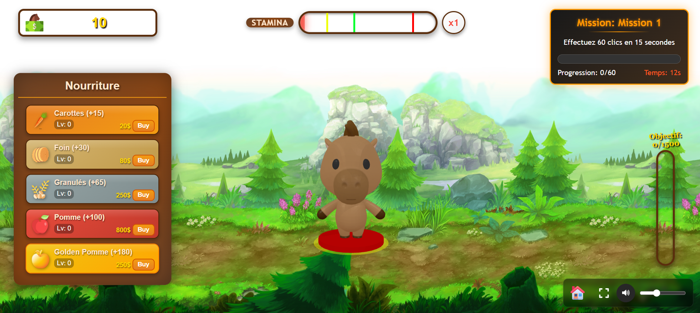

# Horse CLICKER

Un jeu clicker en 3D où vous prenez soin d'un cheval virtuel… et bâtissez un empire équestre.



## Comment jouer

- **Cliquez sur le cheval** (ou appuyez sur Espace) pour gagner de l'argent. Enchaînez les clics pour monter un **combo** (jusqu'à ×2).
- **Nourriture** : recharge la stamina et donne un bonus permanent par clic. Plus la stamina est haute, plus le multiplicateur est fort (×1 → ×3).
- **Bâtiments** : produisent de l'argent tout seuls, même quand vous ne cliquez pas (palefrenier, abreuvoir, écurie, pâturage, manège, haras).
- **Jauge** : remplissez-la pour gagner une ⭐ (+10 % de revenus permanents) et une prime.
- **Missions** : des objectifs chronométrés, générés selon votre progression, avec des récompenses à la clé.
- **Fer à cheval doré** : attrapez-le quand il passe pour ×5 au clic et ×2 revenus pendant 30 s.
- **Nouvelle génération** (prestige) : après 100 000 $ gagnés, repartez de zéro avec des 🏆 (+25 % chacun) et un cheval qui évolue (Poulain → Cheval → Étalon → Champion).
- **Succès** : 15 à débloquer, chacun ajoute +1 % de revenus.
- **Sauvegarde automatique** et **gains hors-ligne** (50 % du revenu passif, plafonnés à 8 h).

## Technologies

- HTML5 / CSS3 / JavaScript (modules ES)
- Three.js pour la 3D
- Vite comme bundler
- Web Audio API pour les effets sonores (aucun fichier audio supplémentaire)

## Jouer en ligne

[https://waelzein6.github.io/HorseClicker/](https://waelzein6.github.io/HorseClicker/)

## Installation locale

```bash
git clone https://github.com/WaelZEIN6/HorseClicker.git
cd HorseClicker
npm install
npm run dev
```

Puis ouvrez l'adresse indiquée (généralement http://localhost:5173/HorseClicker/).

## Déploiement

Le site est déployé automatiquement sur GitHub Pages par le workflow `.github/workflows/deploy.yml` à chaque push sur `master`
(dans les paramètres du dépôt, *Pages → Source* doit être réglé sur **GitHub Actions**).

Déploiement manuel possible aussi :

```bash
npm run build
npm run deploy
```

## Structure du projet

```
HorseClicker/
├── public/
│   ├── assets/          # Modèles 3D (Horse.fbx, LowPolyTrees.glb compressé Draco) et textures WebP
│   ├── draco/           # Décodeur Draco (servi localement)
│   ├── images/          # Fonds, icônes du menu, nourritures
│   └── sound/           # Musique de fond (chargée à la demande)
├── src/
│   ├── css/             # Styles (game.css = nouveaux éléments et responsive)
│   └── js/
│       ├── main.js      # Point d'entrée : boucle unique requestAnimationFrame
│       ├── core/        # data.js (tables), state.js (état + sauvegarde), economy.js (formules)
│       ├── systems/     # missions, bonus, musique, plein écran
│       ├── three/       # scène du cheval et décor du menu
│       └── ui/          # panneaux, effets visuels, sons, formatage des nombres
├── index.html
├── vite.config.js
└── package.json
```

## Auteurs

- Wael ZEIN
- Guillaume Leleux
- Martin Mollat

Amusez-vous bien avec HORSE CLICKER ! 🐴
